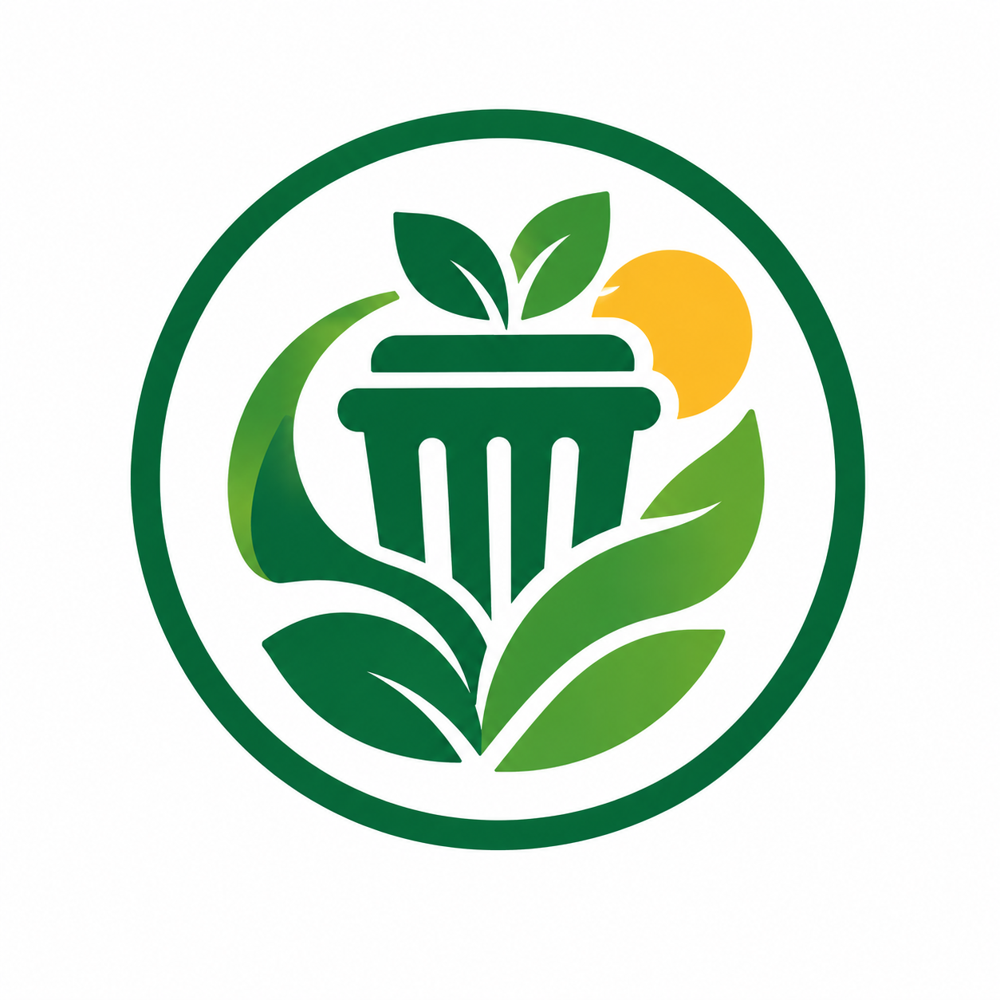

# Bijak Sampah
Website Edukasi Pengelolaan Sampah Rumah Tangga
SDG 11 dan SDG 12

## Anggota Kelompok
1. Zetro Simangunsong - 2515091057 - 
2. I Nyoman Prawira Kerta Nugraha - 2515091119 - 
3. I Gusti Agung Ade Surya Ananta - 2515091033 - 
4. I Made Surya Darma Krisna - 2515091038 -

## Deskripsi Website
- **Tujuan**: Memberikan informasi dan edukasi dasar yang mudah dipahami oleh masyarakat mengenai jenis sampah rumah tangga, cara memilah dari sumbernya, pencegahan sampah makanan, pengomposan mandiri, serta penyaluran ke fasilitas setempat.
- **Manfaat**: Meningkatkan kesadaran masyarakat untuk membangun kebiasaan pemilahan sampah dari rumah, mengurangi timbulan sampah residu, serta mendukung keberlanjutan lingkungan.
- **Sasaran Pengguna**: Masyarakat umum, keluarga, pelajar, dan siapa saja yang ingin memulai kebiasaan pengelolaan sampah secara mandiri dari rumah.

## Halaman Website
1. **Beranda (`index.html`)**: Pengantar tema utama, pentingnya pemilahan sampah, alur sederhana dari penggunaan hingga pengolahan, dan hubungannya dengan SDGs.
2. **Edukasi (`edukasi.html`)**: Penjelasan rinci mengenai 4 kategori sampah (Organik, Daur Ulang, Residu, dan Khusus), contoh, cara penanganannya, serta daftar kesalahan pemilahan yang sering terjadi.
3. **Panduan (`panduan.html`)**: Langkah praktis harian untuk mengurangi dan memilah sampah, target mingguan, serta panduan dasar pengomposan sisa dapur.
4. **Artikel (`artikel.html`)**: Artikel mendalam tentang strategi mengurangi sampah makanan dari dapur dilengkapi data fakta global dari laporan UNEP (Food Waste Index Report 2024).
5. **Tentang (`tentang.html`)**: Informasi mengenai tujuan proyek, sasaran pengguna, cakupan teknologi, identitas anggota kelompok, dan rujukan referensi.

## Teknologi
- **HTML5**: Menggunakan elemen semantik (`<header>`, `<nav>`, `<main>`, `<section>`, `<article>`, `<aside>`, `<footer>`) untuk struktur halaman yang rapi dan mudah diakses (*accessibility-friendly*).
- **CSS3**: Digunakan untuk tata letak dan pengayaan visual eksternal tanpa mengandalkan framework pihak ketiga.
- **Flexbox & CSS Grid**: Digunakan secara murni untuk membangun tata letak responsif, grid kartu, alur proses, dan tata letak multi-kolom.
- **CSS Media Queries**: Menerapkan titik henti (*breakpoints*) responsif pada lebar layar 800px, 760px, 600px, 520px, dan 480px untuk memastikan keterbacaan sempurna di desktop, tablet, dan smartphone.

## Penjelasan Implementasi

### 1. Navigasi Semantik dan Responsif
Navigasi disusun menggunakan kombinasi `<header>`, `<nav>`, dan tautan internal dengan tanda status `aria-current="page"` untuk indikator halaman aktif.

**Potongan Kode HTML (`index.html`):**
```html
<header class="site-header">
  <div class="nav-wrap">
    <a class="brand" href="index.html">
       Bijak Sampah
    </a>
    <nav aria-label="Navigasi utama">
      <a href="index.html" aria-current="page">Beranda</a>
      <a href="edukasi.html">Edukasi</a>
      <a href="panduan.html">Panduan</a>
      <a href="artikel.html">Artikel</a>
      <a href="tentang.html">Tentang</a>
    </nav>
  </div>
</header>
```
*Fungsi Potongan Kode*: Menstrukturkan navigasi utama website secara aksesibel. Atribut `aria-current="page"` memberikan penanda bagi *screen reader* dan digunakan di CSS untuk memberi gaya visual khusus (latar belakang hijau) pada menu halaman yang sedang dibuka.

### 2. Tata Letak Fleksibel & Grid Responsif (CSS Grid & Flexbox)
Pengaturan kartu edukasi dan tim menggunakan CSS Grid murni dengan properti `repeat(minmax())` dan Flexbox untuk penyelarasan elemen secara vertikal maupun horizontal.

**Potongan Kode CSS (`style.css` & `tentang.css`):**
```css
/* Pengaturan Flexbox Navigasi */
.nav-wrap {
    width: min(1100px, calc(100% - 36px));
    min-height: 72px;
    margin: 0 auto;
    display: flex;
    align-items: center;
    justify-content: space-between;
    gap: 20px;
}

/* Pengaturan CSS Grid untuk Kartu Edukasi/Identitas */
.about-grid, .type-grid {
    display: grid;
    grid-template-columns: repeat(2, minmax(0, 1fr));
    gap: 15px;
}
```
*Fungsi Potongan Kode*: `.nav-wrap` memanfaatkan **Flexbox** (`display: flex`) untuk memisahkan logo dan menu navigasi secara otomatis di ujung kiri dan kanan. Properti `.type-grid` memanfaatkan **CSS Grid** (`display: grid`) untuk membagi konten menjadi dua kolom sejajar secara presisi dengan jarak antar kartu sebesar 15px.

### 3. Media Queries untuk Responsivitas Layar Seluler
Responsivitas dibangun secara bertahap (*mobile-friendly*) untuk mengubah tata letak multi-kolom menjadi satu kolom pada layar yang lebih kecil.

**Potongan Kode CSS (`style.css`):**
```css
@media (max-width: 760px) {
    .nav-wrap {
        align-items: flex-start;
        flex-direction: column;
        padding: 12px 0;
        gap: 9px;
    }
}

@media (max-width: 600px) {
    .two-col, .mini-grid, .process-grid, .type-grid {
        grid-template-columns: 1fr;
    }
}
```
*Fungsi Potongan Kode*: Pada ukuran layar di bawah 760px, navigasi akan berubah tumpukan vertikal (`flex-direction: column`). Pada ukuran di bawah 600px, semua grid multi-kolom (`.two-col`, `.type-grid`, dll.) secara otomatis dipaksa menjadi 1 kolom (`1fr`) agar nyaman dibaca di layar smartphone tanpa *scroll* horizontal.

## Struktur Folder
.
├── assets/
│   ├── Gambar 1.jpeg         
│   ├── Gambar 2.jpeg        
│   ├── Gambar 3.jpeg         
│   ├── img 1.jpg             
│   ├── img 2.jpg             
│   ├── img 3.jpg             
│   ├── img 4.jpg              
│   ├── img 5.jpeg            
│   └── logo-bijak-sampah.png  
├── css/
│   ├── artikel.css              
│   ├── edukasi.css              
│   ├── index.css            
│   ├── panduan.css           
│   ├── style.css            
│   └── tentang.css           
├── artikel.html               
├── edukasi.html          
├── index.html              
├── panduan.html              
├── README.md               
└── tentang.html              
```

## Website dan Repository
- **URL GitHub Pages**: https://github.com/agungade901-ship-it
- **URL Repository**: https://github.com/agungade901-ship-it/UTS-Pemweb.git

## Referensi
1. **United Nations** — SDG 11: Sustainable Cities and Communities (`https://sdgs.un.org/goals/goal11`)
2. **United Nations** — SDG 12: Responsible Consumption and Production (`https://sdgs.un.org/goals/goal12`)
3. **United Nations Environment Programme (UNEP)** — *Food Waste Index Report 2024* (`https://www.unep.org/resources/publication/food-waste-index-report-2024`)
